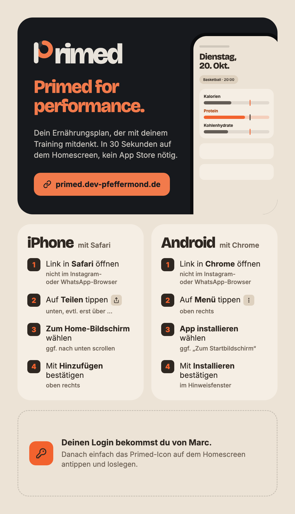

# Primed – Anleitung

Primed ist dein Ernährungsplan, der mit deinem Training mitdenkt: Kalorien, Protein und Kohlenhydrate passen sich an die Art des Tages an, und du siehst jederzeit, was bis zum Training und insgesamt noch offen ist.

## 1. Loslegen

1. Deinen Login (Username und Startpasswort) bekommst du von Marc. Eine Registrierung gibt es nicht.
2. Öffne **https://primed.dev-pfeffermond.de** und melde dich an.
3. Dein Username steht fest und lässt sich nicht ändern; den Anzeigenamen kannst du unter **Menü › Profil** anpassen.
4. Ändere das Startpasswort unter **Menü › Profil › Passwort ändern**, wenn du magst (mindestens 12 Zeichen; ein langer Satz ist ideal).

## 2. Als App auf den Homescreen

Primed braucht keinen App Store. In 30 Sekunden liegt es als App auf deinem Homescreen.

Dieselbe Anleitung als Bild zum Weitergeben: [hell](assets/pwa-installation-light.png) · [dunkel](assets/pwa-installation-dark.png).

**iPhone mit Safari**
1. Link in **Safari** öffnen (nicht im Instagram- oder WhatsApp-Browser).
2. Auf **Teilen** tippen (unten, eventuell erst über „…“).
3. **Zum Home-Bildschirm** wählen (gegebenenfalls nach unten scrollen).
4. Mit **Hinzufügen** bestätigen (oben rechts).

**Android mit Chrome**
1. Link in **Chrome** öffnen (nicht im Instagram- oder WhatsApp-Browser).
2. Auf **Menü** tippen (oben rechts).
3. **App installieren** wählen (gegebenenfalls „Zum Startbildschirm“).
4. Mit **Installieren** bestätigen.

Danach einfach das Primed-Icon antippen. Ohne Internet zeigt die App „Keine Verbindung“; deine Daten liegen nur auf dem Server, nicht auf dem Handy.

## 3. Der Tag in Primed

**Heute**
- Oben steht die **Tagesart** (z. B. Ruhetag, Normal Fitness, Intensiv/Spiel). Antippen, um sie zu ändern, die Trainingszeit und die Dauer einzustellen. „Training ausgefallen“ heißt einfach: Ruhetag wählen.
- Die **Balken** zeigen Kalorien, Protein und Kohlenhydrate gegenüber deinem Soll. Der senkrechte Strich ist der **Checkpoint**: bis dahin solltest du vor dem Training etwa 70 % gegessen haben. Tippe auf einen Balken für Details.
- Ein Tag endet erst um **02:00**: der Shake nach einem späten Spiel zählt noch zum Spieltag.

**Eintragen (+)**
- Suche in deiner Bibliothek, wähle ein Gericht, einen Shake oder etwas, das du um diese Zeit oft isst.
- **Scannen**: Barcode einer Packung (Kamera-Freigabe nötig). Unbekannte Produkte findet Primed oft online bei Open Food Facts; prüfe die Werte, bevor du speicherst.
- Menge in g, ml, EL, TL oder Packung, Uhrzeit per Rad. Im Mengen-Sheet kannst du auch einen früheren Tag wählen und so **nachtragen**.
- Einen Eintrag antippen = bearbeiten, zur Seite wischen = löschen.

**Zauberstab**
- Schlägt vor, was jetzt sinnvoll ist (z. B. großer oder kleiner Shake, proteinreiche Mahlzeit), anhand fester Regeln aus deinen offenen Werten und der Trainingszeit. Ohne KI.

**Essen**
- **Gerichte**: Meal Prep einmal mit Zutaten und Portionen anlegen, dann portionsweise eintragen. Aufgegessene Gerichte landen im Archiv und lassen sich „Nochmal kochen“.
- **Bibliothek**: deine Produkte, Richtwerte für Unverpacktes (z. B. Brötchen) und Zutaten, mit Suche und Filtern.

**Verlauf**
- **Woche**: Bilanz und Tabelle mit Wochensumme. **Monat**: Kalender mit Status pro Tag. **Jahr**: Monatsbalken.
- „Im Rahmen“ heißt: Kalorien innerhalb der Toleranz (Standard ±5 %). Der Status steht immer auch als Symbol da (✓ ↓ ↑).

## 4. Einstellungen (Menü)

- **Darstellung**: System, Hell oder Dunkel.
- **Tagesarten & Sollwerte**: Protein-Standard und Sollwerte pro Tagesart; eigene Tagesarten anlegen. Änderungen gelten ab heute, vergangene Tage bleiben, wie sie waren.
- **Wochenvorlage**: welche Tagesart an welchem Wochentag (mit Trainingszeit).
- **Checkpoints**, **Bewertung** (Toleranz) und **Shakes** (Proteinpulver, Flüssigkeiten, Vorschlags-Schwellen; Shakes lassen sich auch ganz ausschalten).
- **Abmelden** beendet die Sitzung auf diesem Gerät, **Überall abmelden** auf allen Geräten (z. B. wenn ein Handy verloren ging).

### Richtwerte ermitteln

Unter **Tagesarten & Sollwerte › Richtwerte ermitteln** kopierst du einen Fragebogen in eine KI deiner Wahl. Sie fragt dich nach deinen Angaben und schlägt Sollwerte pro Tagesart vor, die du dann einträgst.

> **Hinweis:** Kein Ersatz für ärztliche oder ernährungsfachliche Beratung. Die Werte sind unverbindliche Richtwerte, die eine KI aus deinen Angaben berechnet; Primed übernimmt dafür keine Gewähr. Bei Erkrankungen, Schwangerschaft, Stillzeit oder Essstörungen sprich bitte mit einer Ärztin, einem Arzt oder einer Ernährungsfachkraft.
>
> Deine Antworten gehen an den Anbieter, den du wählst. Primed sendet dabei nichts.

## 5. Deine Daten

- Deine Einträge, Gerichte, Bibliothek und Einstellungen gehören nur dir; andere Nutzer sehen sie nicht.
- Primed nutzt keine Werbung, kein Tracking und keine externen Dienste außer der Produktsuche bei Open Food Facts (dabei wird nur der Barcode oder Suchbegriff übertragen, über den Server, nicht von deinem Gerät).
- Auf deinem Gerät merkt sich Primed nur dein Theme (Hell/Dunkel), damit die App gleich im richtigen Look startet. Die Anmeldung läuft über ein geschütztes Cookie.
- **Konto löschen**: Menü › Profil › Konto löschen, mit deinem Passwort. Dabei werden alle deine Daten endgültig gelöscht.

## 6. Hilfe

| Problem | Lösung |
|---|---|
| Passwort vergessen | Marc setzt es zurück; du bekommst ein neues. |
| Login klappt nicht | Nach mehreren Fehlversuchen ist der Login 15 Minuten gesperrt. Kurz warten. |
| App zeigt eine alte Version | App ganz schließen und neu öffnen. |
| Kamera startet nicht | Kamera-Zugriff für den Browser erlauben (iPhone: Einstellungen › Safari › Kamera). Den Barcode kannst du auch eintippen. |
